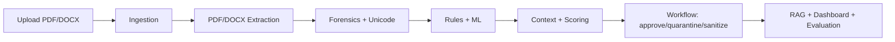

# DocTrap architecture

This project implements the core pipeline in a compact, explainable manner: ingestion validates files, parsing extracts text, forensics detects hidden or disguised instructions, then scoring decides whether to approve or quarantine the document.
